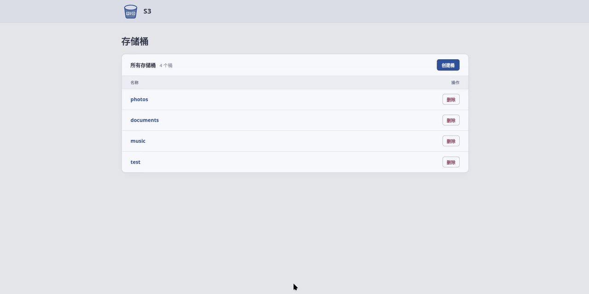

# 从零实现一个 S3

本仓库尝试从 beginner 视角逐步实现一个单机对象存储程序（约 1k 行核心代码）。

## 目录结构

| 路径 | 内容 |
| --- | --- |
| `main.go` | 程序入口：装配存储服务与 HTTP 处理器，监听 `127.0.0.1:8080` |
| `objectstorage/` | 桶与对象的核心操作，并发协调以及 PostgreSQL 元数据与 WebDAV 文件存储 |
| `httpserver/` | HTTP 层，把操作映射成路由并负责流式读写 |
| `web/` | 挂在 `/_ui/` 下的前端静态资源|
| `docs/` | `ADT.md` 数据模型、`specification.md` 规格、`design.md` 设计文档 |

## 当前能力

### 后端

- **桶与对象**：创建、列出和删除空桶；上传、覆盖、下载、列出和删除对象。
- **持久化**：PostgreSQL 保存元数据，WebDAV 文件服务保存对象内容。
- **HTTP API**：通过 HTTP 提供桶、对象和分片上传操作，接口格式由本项目定义，详见 [HTTP 规格](docs/specification.md)。
- **并发控制**：支持单实例内的对象与分片并发操作，不同对象、不同分片可并行处理。
- **分片上传**：创建上传任务、上传和查询分片、完成或取消任务；完成前不影响已发布对象。
- **Range 下载**：支持单个字节范围下载，以及通过 ETag 和 `If-Range` 校验对象版本。
- **异步 GC**：后台清理废弃文件，失败时重试，重启后继续处理已登记的清理任务。

### 前端

打开桶 → 批量上传对象 → 查看上传任务 → 批量下载与删除对象。



## 运行

需先部署好 PostgreSQL 和 WebDAV 服务，并参考 `config.example.json` 填写 `config.json` 中的连接配置，再按照makefile的指引运行，`make status` 可以查看本机 PostgreSQL 集群、WebDAV 服务和 S3 进程的运行状态。

```bash
make help
```
