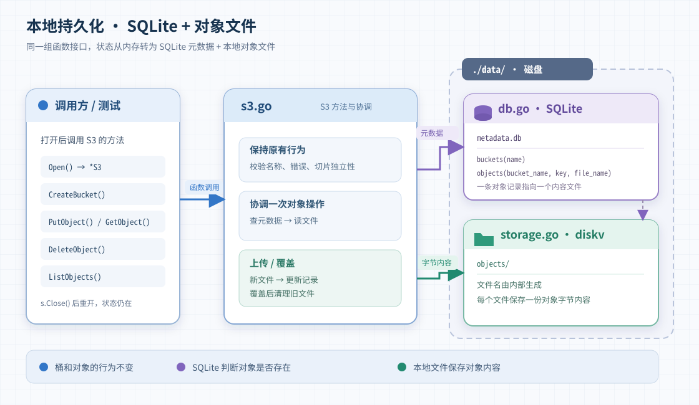

# 对象存储设计

项目分两步实现同一个对象存储模型：[ADT.md](ADT.md) 定义桶、key 和对象内容；[specification.md](specification.md) 定义七个对外操作的行为。第一步实现内存版，第二步在此基础上增加持久化。

## 第一步：内存版

先通过函数调用提供创建、列出和删除桶，以及上传、读取、删除和列出对象。存储包直接管理状态；调用方无需了解其数据结构。

第一步的 `s3.go` 用两层 map 保存状态：外层以桶名找到桶，内层以 key 找到对象的字节切片。创建桶时初始化空的内层 map；桶列表遍历外层 map。删除桶先查找名称，再检查内层 map 是否为空；非空时不修改状态，空桶则从外层 map 删除。上传时复制输入字节，读取时返回副本，避免进程内调用者通过共享切片改动存储内容。函数按规格校验输入并返回错误。此时状态只在进程内，退出后即消失。

## 第二步：本地持久化

保留七个操作的对外行为，把状态从内存移到当前工作目录下的 `data/`。`Open()` 创建或打开存储并返回一个 `S3` 实例；七个操作成为它的方法，`s.Close()` 关闭该实例。当前程序只持有一个实例；正常关闭后再次打开，已成功完成的操作仍然有效。

### 数据如何放置

| 位置 | 保存什么 |
| --- | --- |
| `data/metadata.db` | SQLite 元数据：`buckets(name)`；`objects(bucket_name, key, file_name)` |
| `data/objects/` | diskv 按内部名称保存对象字节，每个对象对应一个文件 |

`buckets.name` 唯一；`objects` 以 `(bucket_name, key)` 标识一个对象，并关联已有桶。`file_name` 是内部生成的唯一文件名，不直接使用用户的 key。这样空桶仍有记录，同 key 覆盖也可以改为指向新文件。

### 操作如何经过两处存储

`s3.go` 定义 `S3` 及其对外方法，负责参数校验和操作顺序；`db.go` 只读写 SQLite 元数据；`storage.go` 通过 diskv 读写对象文件。diskv 使用默认的单层目录布局，并开启 16 MiB 的内存读取缓存；桶、用户 key 和对象列表仍由 SQLite 管理。三个文件仍属于同一个 `s3` 包，不使用全局的当前存储实例。

- `CreateBucket` 写入桶表；`ListBuckets` 从桶表读取名称。`DeleteBucket` 仅删除没有对象的桶，检查和删除在同一条数据库语句中完成；对象存在时不改变状态。
- `ListObjects` 从对象表读取指定桶的 key。
- `PutObject` 先写新内容文件，再把对象记录指向它；覆盖后清理旧文件。
- `GetObject` 先查文件名，再读取文件并返回独立的字节切片。
- `DeleteObject` 先删除对象记录，再清理对应文件；不存在的 key 仍返回 `nil`。

本阶段验证正常读写、关闭和重新打开。元数据读写与对象文件读写出错时向调用方返回错误；记录更新后的旧文件清理由程序尽力完成。当前 demo 不保证进程崩溃或断电后的恢复，也不清理因此遗留的文件。

