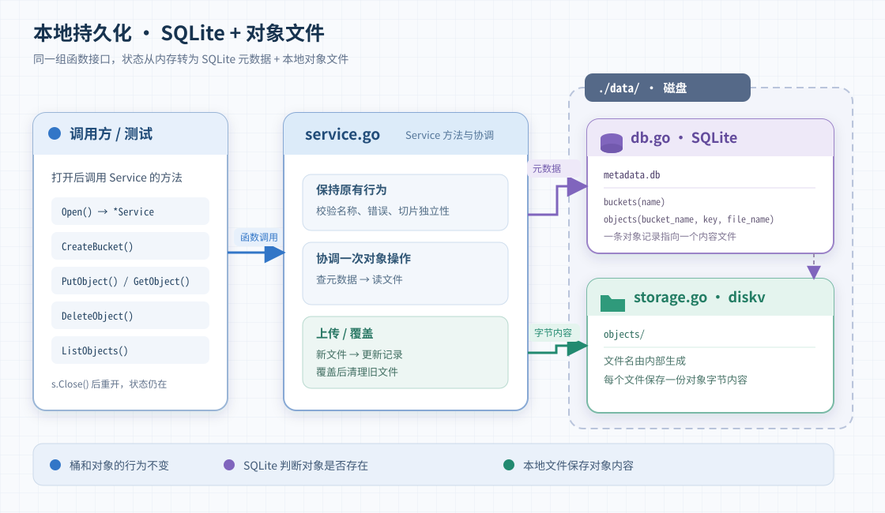
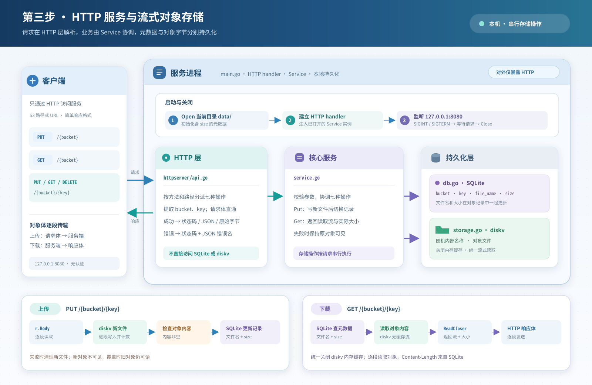

# 对象存储设计

项目分阶段实现同一个对象存储模型：[ADT.md](ADT.md) 定义桶、key 和对象内容；[specification.md](specification.md) 定义对外行为。第一步实现七个基本操作，第二步增加持久化，第三步提供 HTTP 服务并改为流式传输。

## 第一步：内存版

先通过函数调用提供创建、列出和删除桶，以及上传、读取、删除和列出对象。它们的行为由规格文档中对应的七节规定。

第一步用两层 map 保存状态：外层以桶名找到桶，内层以 key 找到对象的字节切片。创建桶时初始化空的内层 map；列出桶时遍历外层 map；删除桶时先检查内层 map 是否为空。上传时复制输入字节，读取时返回副本，避免进程内调用者通过共享切片改动存储内容。函数按规格校验输入并返回错误。此时状态只在进程内，退出后即消失。

## 第二步：本地持久化

保留七个操作的对外行为，把状态从内存移到当前工作目录下的 `data/`。`Open()` 创建或打开存储并返回可操作实例；七个操作成为它的方法，`Close()` 关闭该实例。当前程序只持有一个实例；正常关闭后再次打开，已成功完成的操作仍然有效。

### 数据如何放置

| 位置 | 保存什么 |
| --- | --- |
| `data/metadata.db` | SQLite 元数据：`buckets(name)`；`objects(bucket_name, key, file_name)` |
| `data/objects/` | diskv 按内部名称保存对象字节，每个对象对应一个文件 |

`buckets.name` 唯一；`objects` 以 `(bucket_name, key)` 标识一个对象，并关联已有桶。`file_name` 是内部生成的唯一文件名，不直接使用用户的 key。这样空桶仍有记录，同 key 覆盖也可以改为指向新文件。

### 操作如何经过两处存储

业务方法负责参数校验和操作顺序；`db.go` 只读写 SQLite 元数据，`storage.go` 通过 diskv 读写对象文件。第二步曾使用 diskv 默认的单层目录布局和 16 MiB 内存读取缓存；第三步改为流式读取后不再启用缓存。桶、用户 key 和对象列表仍由 SQLite 管理。这些代码属于同一个包，不使用全局的当前存储实例。

- `CreateBucket` 写入桶表；`ListBuckets` 从桶表读取名称；`DeleteBucket` 仅删除空桶，检查和删除在同一条语句中完成。
- `ListObjects` 从对象表读取指定桶的 key。
- `PutObject` 先写新内容文件，再把对象记录指向它；覆盖后清理旧文件。
- `GetObject` 先查文件名，再读取文件并返回独立的字节切片。
- `DeleteObject` 先删除对象记录，再清理对应文件；不存在的 key 仍返回 `nil`。

本阶段验证正常读写、关闭和重新打开。元数据读写与对象文件读写出错时向调用方返回错误；记录更新后的旧文件清理由程序尽力完成。当前 demo 不保证进程崩溃或断电后的恢复，也不清理因此遗留的文件。

## 第三步：HTTP 服务与流式传输

### 整体结构

客户端向 `127.0.0.1:8080` 发送 HTTP 请求。服务程序打开当前工作目录下的 `data/`，启动监听，并把请求交给 HTTP handler。handler 根据方法和路径选择七个操作之一，将请求内容交给对应的 `Service` 方法，再把结果转换成规格规定的 HTTP 响应。

服务入口放在根目录的 `main.go` 中，不属于 `objectstorage` 存储包。HTTP 接口放在 `httpserver/api.go` 中，负责解析请求、调用存储方法、转换响应。`httpserver.NewHandler` 接收只包含七个存储操作的 `objectService` 接口，运行时由 `*objectstorage.Service` 提供；`objectstorage` 包负责存储操作及持久化，HTTP 层不直接读写元数据或对象文件。

本阶段让请求依次完成存储操作，不引入并发存储处理。

### 目录组织

`docs/` 保存 `ADT.md`、`specification.md`、`design.md`，架构图放在 `docs/images/`；`objectstorage/` 放 `service.go`、`db.go`、`storage.go` 与 `service_test.go`；`httpserver/` 放 `api.go` 及其测试；根目录放 `main.go` 与启动测试。测试与所测代码同目录，不再按测试类型集中到一个目录。

### 启动与关闭

根目录的程序先调用 `Open` 获取 `Service` 实例，再用该实例建立 HTTP handler，最后监听 `127.0.0.1:8080`。如果打开存储失败，服务不开始监听；如果监听失败，关闭已打开的实例并报告错误。

收到终端的 Ctrl-C（SIGINT）或 SIGTERM 时，服务停止接收新请求，等待已开始的请求结束，再调用 `Close` 退出。监听意外结束时也关闭实例并报告错误。

### 请求分派

`httpserver` 使用标准库 `http.ServeMux` 按方法和路径注册七个操作。`GET /` 列出全部桶，`/{bucket}` 对应单桶操作，`/{bucket}/{key...}` 对应对象操作；handler 通过 `PathValue` 取得参数。使用可匹配剩余路径的 `key...`，让含额外 `/` 的 key 仍交给 `Service` 校验。

handler 保留空名称、空 key 和不规范路径的原始含义，避免路由器重定向后改变参数错误；由 `Service` 方法按规格校验参数。上传时将 HTTP 请求体直接传给 `PutObject`；其他操作只传路径参数。方法返回后，handler 再按规格转换为 HTTP 响应。

### 响应转换

handler 根据操作结果生成规格规定的状态码和响应体：创建桶返回 `201`，上传和删除返回 `204`，桶列表和对象列表分别序列化为 JSON；下载使用 `GetObject` 返回的大小设置 `Content-Length`，将读取流逐段写入响应体，并始终关闭读取流。

业务错误按规格中的错误表转换为状态码和 JSON 错误名，包括非空桶删除映射为 `409 BucketNotEmpty`；其他存储错误返回 `500 InternalError`。

### 对象读写与存储

`PutObject` 从 `io.Reader` 逐段写入新对象文件，同时统计实际字节数。内容为空时删除新文件；写入完成后，将新文件名和实际大小一起更新到 SQLite，再清理覆盖前的旧文件。

`GetObject` 从 SQLite 读取文件名和大小，再通过不启用内存缓存的 diskv 实例调用 `ReadStream`，返回读取流和大小。对象大小用于 HTTP 的 `Content-Length`；本阶段不按大小选择读取方式。

第三步创建对象表时加入大小字段，不迁移第二步格式的数据库。实现时先完成元数据与流式存储，再更新 `Service` 方法、HTTP handler 和服务入口，每步用对应测试验证。

## 第四步：本地网页界面

### 组件和状态

`main.go` 从工作目录的 `web/` 提供 `/_ui/` 静态文件，其他路径继续交给现有 HTTP handler。`_ui` 不是合法桶名，因而网页路由不会占用桶 `ui` 的 API 路径。网页与 API 同源，静态文件随可执行文件一起复制，并与运行时的 `data/` 分开。网页采用原生 HTML、CSS 和 JavaScript：页面提供列表与操作对话框，脚本负责请求和更新视图。

浏览器只保存当前桶和最近读取的列表。进入页面或桶时读取对应列表；写操作成功后重新读取，以服务端结果为准。当前没有并发修改者，最近读取的对象列表也可用于判断上传是否覆盖已有 key。动态名称作为文本渲染，避免被当作 HTML 解释。

### 关键流程与失败处理

创建和上传在对话框中收集输入；输入变化时校验非空的桶名或 key，提交时连同空值再次校验。文件名合法时用作默认 key；若 key 已存在，确认覆盖后才上传。文件内容直接作为 HTTP 请求体，不做文本转换。删除也经由确认对话框，确认后才发请求。取消这些操作不写入数据。

下载优先使用浏览器提供的保存位置选择能力；用户取消时不读取对象。缺少该能力时触发常规下载，由浏览器决定保存位置。当前网页下载只面向非 GB 级对象。

请求路径分别编码桶名和 key。写请求失败时保留表单输入以便重试；收到写入成功响应后关闭表单，再读取列表。若后续读取失败，保留旧列表并明确提示写入已完成、列表尚未更新，避免用户重复提交。初次读取失败时展示错误，不虚构列表。完成顺序为静态路由、列表与写操作、上传及下载，分别用启动测试和浏览器测试验证。
